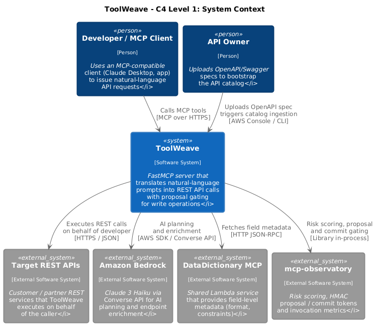

# ToolWeave

**Turn OpenAPI specs into MCP tools that plan safe REST calls from natural language—with gated writes and catalog-bound egress.**

ToolWeave is for teams who want AI clients (Claude, VS Code MCP, custom agents) to call **their** HTTP APIs without hand-writing every tool or exposing an SSRF-prone generic HTTP action.

| | |
|---|---|
| **License** | [Apache-2.0](LICENSE) |
| **Stack** | Python 3.12, FastMCP, AWS Lambda/SAM, Amazon Bedrock |
| **Offline dev** | Unit tests via moto (no AWS account required) |
| **Production** | Requires AWS (see [Operations](docs/OPERATIONS.md)) |

<!-- Demo: add a short GIF here (plan → GET / proposal → commit). Placeholder until recorded. -->



---

## What you get

Five MCP tools:

| Tool | Role |
|------|------|
| `pre_tool` | Plan a call from a prompt; ask one question if required fields are missing |
| `post_tool` | Run GETs now; turn writes into observatory proposals |
| `commit_api_call` | Verify and execute an approved write |
| `reload_catalog` | Refresh the in-memory catalog from DynamoDB |
| `health` | Liveness and endpoint count |

Reads execute immediately. Writes never run on the first hop—they go through [mcp-observatory](https://github.com/rajatarun/mcp-observatory) proposal/commit semantics.

More detail: [Architecture](docs/architecture.md) · [Security notes](docs/design/security-notes.md) · [Integrations](docs/INTEGRATIONS.md)

---

## 5-minute quickstart (offline)

Verified on a clean clone with Python 3.12:

```bash
git clone https://github.com/rajatarun/ToolWeave.git
cd ToolWeave
python3 -m venv .venv
source .venv/bin/activate
pip install -e ".[dev]"
python3 -m pytest tests/ -q
```

Parse a sample OpenAPI file without AWS:

```bash
python3 examples/parse_spec.py
```

You should see **170 passed** (plus any expected xfails) and three petstore endpoints printed.

To run the MCP HTTP entrypoint locally you need AWS-backed configuration (Bedrock, DynamoDB, etc.); tests mock those dependencies.

---

## Copy-paste workflow examples

These illustrate the MCP tool sequence against a **deployed** server with a valid bearer token. JSON shapes are indicative—use your client's MCP RPC format.

**1. Check the server**

```text
Tool: health
Args: {}
```

**2. Plan from natural language**

```text
Tool: pre_tool
Args: { "prompt": "Get pet 42" }
```

If the response has `"status": "needs_input"`, answer the single question in a follow-up `pre_tool` call with the same `session_id`.

**3. Execute a read**

```text
Tool: post_tool
Args: { "api_call_plan": <object returned when pre_tool status is ready> }
```

When `execution_type` is `proposal`, confirm with the user and call `commit_api_call` with the returned `proposal_id` and `commit_token`.

Client wiring example: [`examples/mcp_client_config.example.json`](examples/mcp_client_config.example.json).

---

## Add your API

1. Place OpenAPI 3.x or Swagger 2 under [`src/Swagger/`](src/Swagger/).
2. Ensure `servers` resolves to a real base URL (see `scripts/publish_specs.py`).
3. Deploy or upload to your specs bucket; call `reload_catalog`.

Extension guide: [`docs/EXTENDING.md`](docs/EXTENDING.md).

---

## Deploy and configure

```bash
sam build
sam deploy
```

Full operations guide: [`docs/OPERATIONS.md`](docs/OPERATIONS.md).

Environment variable reference: [`.env.example`](.env.example) (use placeholders for your account).

---

## MCP authentication

The deployed `/mcp` route requires a bearer token. Create the Secrets Manager
secret before relying on auth in production:

```bash
aws secretsmanager create-secret \
  --name toolweave/mcp-auth-token \
  --secret-string "$(openssl rand -hex 32)"
```

Send the token on every `/mcp` request:

```http
Authorization: Bearer <token>
```

Example MCP client transport via `mcp-remote` (replace placeholders):

```json
{
  "mcpServers": {
    "toolweave": {
      "command": "npx",
      "args": [
        "-y",
        "mcp-remote",
        "https://<api-id>.execute-api.us-east-1.amazonaws.com/mcp",
        "--header",
        "Authorization:${TOOLWEAVE_AUTHORIZATION}"
      ],
      "env": {
        "TOOLWEAVE_AUTHORIZATION": "Bearer <token>"
      }
    }
  }
}
```

CipherWeave JWT access tokens (`aud=toolweave`) and tool scopes are described in
[`docs/OPERATIONS.md`](docs/OPERATIONS.md).

---

## Project layout

```text
src/toolweave/     MCP server, agent, executor, ingestion
src/Swagger/       API specs published on deploy
tests/             moto-backed unit tests
examples/          Offline parser demo + MCP client template
docs/              Architecture, integrations, launch draft
template.yaml      SAM infrastructure
```

---

## Contributing

We welcome issues and PRs. See [CONTRIBUTING.md](CONTRIBUTING.md), [CODE_OF_CONDUCT.md](CODE_OF_CONDUCT.md), and candidate starter tasks in [docs/GOOD_FIRST_ISSUES.md](docs/GOOD_FIRST_ISSUES.md).

Report security issues per [SECURITY.md](SECURITY.md)—not public issues.

---

## Development checks

```bash
python3 -m pytest tests/ -q
```

Optional: `python3 -m ruff check .`

---

## License

Apache License 2.0 — see [LICENSE](LICENSE).
